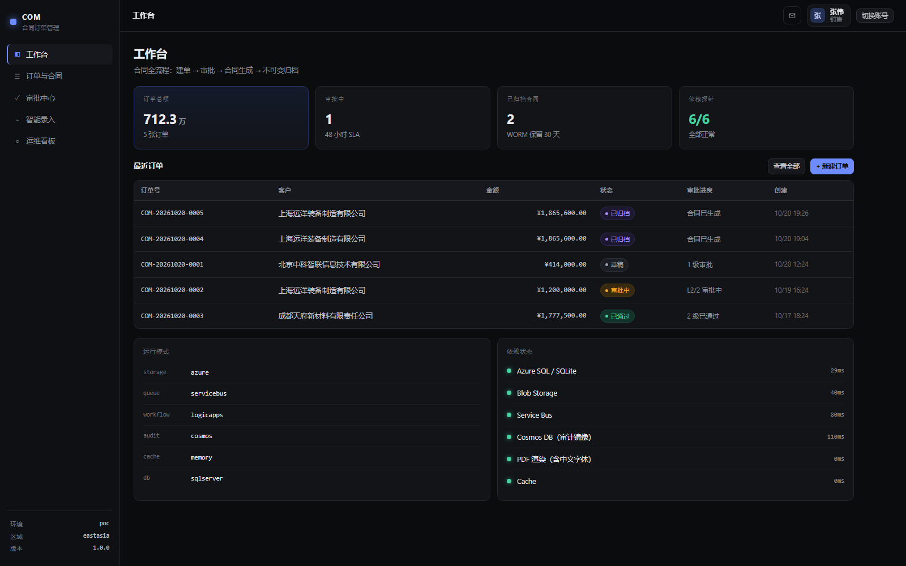

# COM · 合同订单管理系统（Azure 教学演示）

一套运行在 Azure 上的**合同订单管理系统** PoC，用于 Azure 授课培训中讲解 App Service、Functions、Logic Apps、Service Bus、Azure SQL、Blob 不可变存储、Cosmos DB、Key Vault 与 Private Endpoint 等模块。

设计原则是**每个 Azure 依赖都有一个接口 + 两个实现**（Azure / 本地），靠应用设置切换。因此这套代码既能一键部署到云端，也能在一台没装任何 Azure 组件的笔记本上 `dotnet run` 跑通全部业务流程 —— 课堂现场断网也不至于翻车。



---

## 业务范围

一条完整的合同订单链路：

```
销售建单 → 分级审批（Logic Apps 挂起等待）→ 生成合同 PDF → WORM 归档 → 审计留痕
```

**审批分档**（`ApprovalRules.Chain`）：

| 金额 | 审批链 | 说明 |
|---|---|---|
| < ¥500,000 | `approver1` | 1 级，销售总监 |
| ¥500,000 – ¥2,000,000 | `approver1 → finance` | 2 级，逐级串行 |
| ≥ ¥2,000,000 | `approver1 → finance → admin` | 3 级，逐级串行 |

**状态机**（单一入口 `OrderStateMachine.Next()`，非法流转返回 `409`）：

```
Draft ──submit──> PendingApproval ──approve(末级)──> Approved ──> Contracted ──> Archived
  │                      │
  └──cancel──> Cancelled └──reject──> Rejected
```

---

## 技术栈

| 层 | 选型 | 备注 |
|---|---|---|
| 运行时 | .NET 8 / C# 12 | 全程 `DefaultAzureCredential` + 系统分配托管标识，**零密钥** |
| API | ASP.NET Core Minimal API | 统一 `application/problem+json` + `traceId` |
| 数据 | EF Core 8 | SqlServer / Sqlite 双提供程序，靠 `DB_PROVIDER` 切换 |
| 门户 | 原生 HTML / CSS / JS | 无构建步骤，零 npm 依赖 |
| PDF | QuestPDF（Community） | 内嵌 Noto Sans SC，中文字体随程序集打包 |
| 异步 | Azure Functions（.NET 8 Isolated） | Service Bus 触发器，与 API 共用 Handler |
| 工作流 | Logic Apps（Consumption） | `HttpWebhook` 挂起等审批，48h 超时 |
| 基础设施 | Bicep 单文件 + Bash | `profile=full\|lite` 可裁剪 |

**没有 Redis**：East Asia 最小规格月费约 $16，而这个演示的并发量讲不出缓存故事。保留 `ICacheStore` 抽象与 `enableRedis` 开关，需要时再开。

---

## 目录结构

```
.
├── COM-Azure-Architecture-v1.html        # 架构设计基线（资源清单 / ADR / 网络 / RBAC）
├── COM-System-Design-and-Deploy-Plan.html # 模块详情 / 技术栈 / 部署方案 / 踩坑记录
└── com/
    ├── Com.sln
    ├── src/
    │   ├── Com.Shared/                   # 领域层、EF、平台适配器、PDF 渲染、作业 Handler
    │   ├── Com.Api/                      # Minimal API + wwwroot 门户（同一发布包，靠 APP_ROLE 分角色）
    │   └── Com.Worker/                   # Azure Functions，Service Bus 触发器
    ├── infra/
    │   ├── main.bicep                    # 单文件基础设施（VNet / SQL / Blob / SB / Cosmos / PE / RBAC）
    │   ├── deploy.sh                     # 三阶段部署：core → net → gov
    │   ├── teardown.sh                   # 先解 WORM 策略再删资源组
    │   ├── verify.py                     # 端到端 20 项验收
    │   └── demo.http                     # 课堂现场可直接点发的请求集
    └── .shots/                           # 云端运行截图
```

---

## 本地运行（无需 Azure）

```bash
cd com/src/Com.Api
dotnet run
```

打开 <http://localhost:5179>。默认走 `sqlite + local file + 进程内队列`，首次启动自动建库并写入种子数据。

**演示账号**（统一密码 `Com@2026`）：

| 账号 | 角色 | 姓名 |
|---|---|---|
| `sales@com.demo` | 销售 | 张伟 |
| `director@com.demo` | 销售总监（`approver1`） | 李强 |
| `finance@com.demo` | 财务 | 王敏 |
| `gm@com.demo` | 管理员（`admin`） | 陈静 |

门户支持 `?as=finance@com.demo` 角色直达自动登录，省掉现场反复输密码（受 `/config.json` 的 `demoAutoLogin` 控制，云端默认关闭）。

---

## 部署到 Azure

### 前置

- Azure CLI 已登录（`az login`），且有目标订阅的 Contributor 权限
- .NET 8 SDK
- Bicep CLI（`az bicep` 损坏时可用 `~/.azd/bin/bicep.exe`，`deploy.sh` 已做三级回退）

### 一键部署

```bash
cd com
bash infra/deploy.sh \
  --subscription <your-subscription-id> \
  --location eastasia \
  --name com-poc \
  --profile full \
  --email you@example.com
```

脚本会：创建资源组 → 复用或生成 `.secrets.env`（SQL 密码 / JWT 密钥 / 内部密钥）→ 编译 ARM → 部署基础设施 → 发布 API 与 Function → 回写工作流触发器地址 → 打印门户地址与验收命令。

> `.secrets.env` 已在 `.gitignore` 中，**不要提交**。脚本检测到已存在时会直接复用，不会重新生成。

### 分阶段（推荐课堂演示用）

| 阶段 | 操作 | 讲什么 |
|---|---|---|
| P1 `core` | 建库表 + 种子数据，公网可达 | 先让链路通起来 |
| P2 `net` | 关闭公网、挂 Private Endpoint ×4 | 再收紧攻击面 |
| P3 `gov` | RBAC、诊断设置、预算告警 | 最后补治理 |

顺序本身就是方法论：**先连通、再收紧**。一上来就上 PE，排障时会分不清是代码问题还是网络问题。

`--no-pe` 跳过私有终结点，`--infra-only` 只建基础设施，`--publish-only` 只发代码，`--what-if` 只预览。

### 验收

```bash
python infra/verify.py https://<your-api-app>.azurewebsites.net
```

覆盖 20 项：健康检查 → 建单 → 分档判定 → 逐级审批 → 合同生成 → WORM 归档 → SHA256 重算 → 越权 404 → 未认证 401 → 内部端点鉴权。

看审批返回值能判断工作流是否真的在跑：`resumed` 表示 Logic Apps 挂起后被回调唤醒（正确），`inline` 表示退化成了 API 内部推进。

### 清理

**这套环境约 $2.5–3.5/天，讲完务必销毁。**

```bash
bash infra/teardown.sh --name com-poc --location eastasia --dry-run   # 先看清单
bash infra/teardown.sh --name com-poc --location eastasia --yes
```

脚本会先删 Blob 容器的不可变策略（未锁定状态）再删资源组 —— 漏这一步，存储账户会因 WORM 保护一直挂着计费。

---

## 几个值得讲的设计取舍

- **App Service 选 S1 而非 P0v3**：按 East Asia 实际单价，S1 `$0.10/h` 反而比 P0v3 `$0.1885/h` 便宜近一半。
- **Service Bus 不挂 Private Endpoint**：PE 只支持 Premium SKU（Standard 直接报 `PrivateEndpointInvalidSku`），Premium 月费约 $677。改为「公网入口 + `disableLocalAuth` + 仅托管标识授权」，攻击面收敛到身份层。
- **WORM 用未锁定策略**：30 天保留，但保持 `Unlocked`，便于课后清理。合规场景应改为 `Locked`。
- **PDF 渲染放在与宿主无关的 Handler 里**：API 可内联调用，Function 挂了也能演示 —— 这是课堂的保险丝。
- **审批回调地址存在 `ApprovalTask.CallbackUrl`**：等价于凭据，绝不出现在任何对外 DTO 中。

更多实现细节与 9 处实际部署偏差，见 `COM-System-Design-and-Deploy-Plan.html` 第 12 章。

---

## 接口一览

| 方法 | 路径 | 说明 |
|---|---|---|
| POST | `/api/auth/login` | 登录，返回 HS256 JWT（8h） |
| GET | `/api/orders` | 订单列表（销售仅见自己创建的） |
| POST | `/api/orders` | 新建订单（支持 `IdempotencyKey`） |
| GET | `/api/orders/{id}` | 详情，含审批链 / SAS / 审计时间线 |
| POST | `/api/orders/{id}/submit` | 提交审批 |
| GET | `/api/approvals/pending` | 我的待办 |
| POST | `/api/approvals/{taskId}/decision` | 批准 / 驳回 |
| POST | `/api/contracts/{orderId}/generate` | 触发生成，`202` + 投递队列 |
| GET | `/api/contracts/{contractId}/verify` | 重算 SHA256 校验完整性 |
| GET | `/api/ops/deps` | 依赖探针（6 项） |
| GET | `/api/ops/summary` | 运行模式与统计 |

错误语义统一：非法状态流转 `409`、参数校验 `400`、资源不存在或越权 `404`（**不用 403**，避免泄露资源存在性）、其余 `500`。

---

## 说明

- 本项目为**教学演示用途**，未做生产级加固：JWT 密钥由部署脚本生成并写入应用设置、演示账号密码硬编码在 `Seeder.cs`、未接入真实身份提供商。
- 部署后请勿在公网长期运行，更不要把演示账号用于任何真实数据。
- 内嵌字体 Noto Sans SC 采用 [SIL Open Font License 1.1](https://scripts.sil.org/OFL)。
